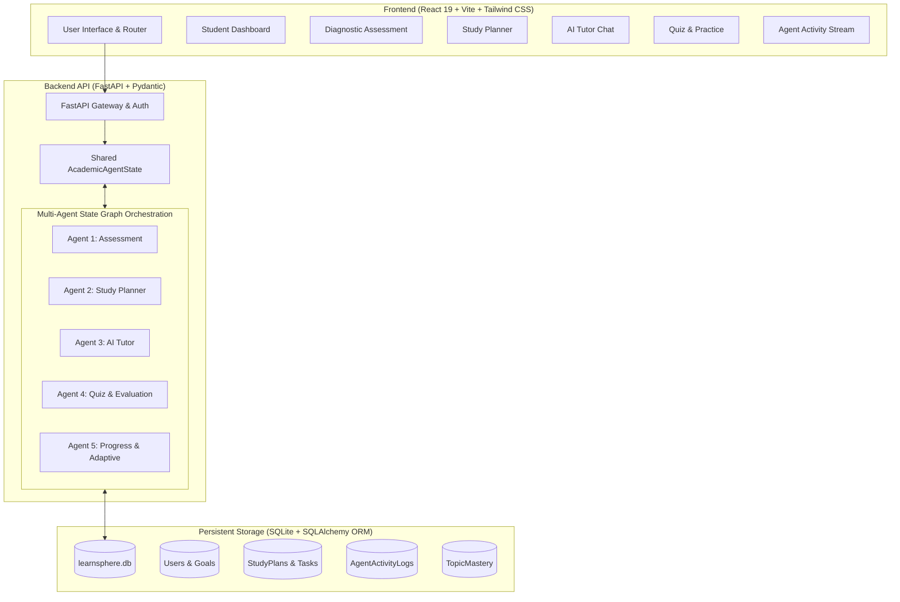
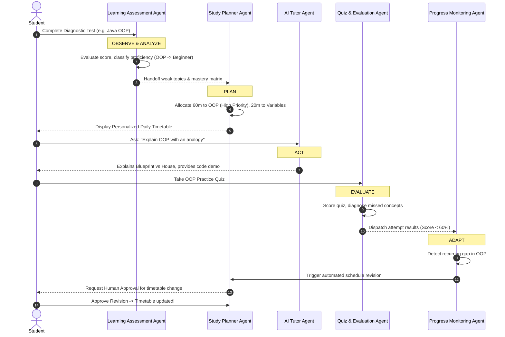

# LearnSphere AI - Agentic AI-Based Personalized Learning and Academic Success System

A state-of-the-art educational platform powered by **autonomous collaborating AI agents** orchestrated with **LangGraph**, designed to systematically elevate college students' academic performance through intelligent gap analysis, personalized study planning, interactive tutoring, and automated closed-loop learning adaptation.

---

## 🌟 Key Highlights & Capabilities

- **Genuine Agentic AI Architecture**: Built on the complete feedback loop:  
  **Observe → Analyze → Plan → Act → Evaluate → Adapt**
- **Five Specialized Autonomous Agents**:
  1. **Learning Assessment Agent**: Conducts diagnostic testing, calculates deterministic topic mastery, and classifies proficiency into *Beginner*, *Intermediate*, or *Advanced*.
  2. **Personalized Study Planner Agent**: Analyzes gaps, dynamic time availability, and weights study durations (up to 60 mins for weak topics vs 20 mins for mastered topics). Enforces **Human-in-the-Loop** approval before major schedule revisions.
  3. **Intelligent AI Tutor Agent**: Socratic conversational tutor adjusting complexity to student proficiency, providing real-world analogies, step-by-step key takeaways, and runnable code examples (Gemini API supported with deterministic fallback).
  4. **Quiz Generation & Evaluation Agent**: Generates difficulty-tailored MCQs (Easy, Medium, Hard), guards solutions on the backend until submission, scores responses, and detects misconceptions.
  5. **Progress Monitoring & Adaptive Learning Agent**: Inspects trajectory trends, detects persistent gaps, and autonomously triggers study-plan adaptations and schedule replanning.
- **Zero-Setup Reviewer Demo Mode**: College reviewers can evaluate the system out of the box with one-click demo login, pre-seeded subjects, and realistic trace logs—no API keys required.
- **Auditable Agent Trace Logs**: Every agent observation, reasoning step, decision, and state handoff is recorded in SQLite and inspectable via the **Agent Activity Dashboard**.

---

## 🏗️ System Architecture



---

## 🔄 Multi-Agent Collaboration Workflow (The Agent Cycle)



---

## 🚀 Quick Start Guide (Windows)

### Prerequisites
- **Python 3.10+** (verified on Python 3.11)
- **Node.js 18+** (verified on Node.js v24 & npm 11)

### 1. Launch Everything with 1-Click (Recommended)
Double-click `run_demo.bat` in the project root, or execute:
```powershell
.\run_demo.bat
```

---

### 2. Manual Startup Instructions

#### Backend Setup
```powershell
cd backend
# Create virtual environment if not already created
python -m venv venv
.\venv\Scripts\activate

# Install dependencies
pip install -r requirements.txt

# Run automated tests to verify agent logic
$env:PYTHONPATH="."
pytest -v

# Start FastAPI server
uvicorn app.main:app --host 0.0.0.0 --port 8000 --reload
```
*Backend runs on `http://localhost:8000` (Interactive API docs at `http://localhost:8000/docs`).*

#### Frontend Setup
```powershell
cd frontend
# Install dependencies
npm install

# Start Vite dev server
npm run dev -- --host 0.0.0.0 --port 5173
```
*Frontend runs on `http://localhost:5173`.*

---

## 🧪 Demonstration Scenario (Java Programming Review)

Follow these steps for your college project review:

1. **Open the Web Application**: Navigate to `http://localhost:5173/auth`.
2. **Instant Demo Login**: Click the purple **"Instant Reviewer Demo Login"** button. This logs in as **Alex Rivera** (`demo@learnsphere.ai`).
3. **Inspect the Student Dashboard**: Notice the active subject (**Java Programming**), KPI cards, Recharts mastery trajectory, and the interactive **Autonomous Agent Cycle** visualizer.
4. **Conduct Diagnostic Assessment**:
   - Navigate to **"Diagnostic Test"** in the sidebar.
   - Answer the 5 diagnostic questions covering Variables, Loops, Arrays, OOP, and Exception Handling.
   - Intentionally choose an incorrect answer for the **OOP** question.
   - Click **"Submit Diagnostic for Gap Analysis"**.
   - Review the generated **Knowledge Profile & Gap Report** showing OOP classified as **Beginner (Weak)**.
5. **Inspect the Study Planner**:
   - Click **"View Personalized Study Plan"**.
   - Notice the Study Planner Agent has allocated **High Priority (45-60 min)** blocks to OOP.
   - Toggle task completion checkboxes.
   - Test the daily hours tuner (e.g., switch to 3.0 hrs/day and click *Regenerate Plan*).
6. **Chat with AI Tutor**:
   - Navigate to **"AI Tutor Chat"**.
   - Ask: *"Explain Object-Oriented Programming with a simple analogy"*.
   - View the tailored response with step-by-step key points, copyable Java code snippets, and suggested follow-up prompts.
7. **Take a Targeted Quiz**:
   - Navigate to **"Quizzes & Practice"**.
   - Select **Object-Oriented Programming (OOP)**, difficulty **Medium**, and click **"Generate Practice Quiz"**.
   - Submit answers and view question-by-question explanations with misconception tagging.
8. **Verify the Agent Activity Dashboard**:
   - Navigate to **"Agent Activity"** in the sidebar.
   - Inspect the live operational states of all 5 agents.
   - Click **"Execute Demonstration Cycle"** to trigger the complete LangGraph state graph in real time!
   - Expand any trace card to inspect the exact input/output JSON payloads exchanged between agents.

---

## 🗄️ Database Schema & Entities

The SQLite database (`learnsphere.db`) contains 16 normalized tables:

| Table | Purpose |
|---|---|
| `users` | User credentials, password hash, avatar color |
| `subjects` | Standard and custom academic courses (Java, Python, DSA, etc.) |
| `topics` | Fine-grained subject topics with difficulty and key concepts |
| `student_goals` | Target grades, daily available hours, preferred learning style |
| `assessments` | Diagnostic test sessions, scores, and proficiency summaries |
| `assessment_questions` | Question pool linked to topics |
| `assessment_answers` | Student submitted options and accuracy |
| `study_plans` | Active & pending adaptive study plans |
| `study_tasks` | Daily tasks with day-of-week, priority, minutes, and completion |
| `quizzes` | Dynamic topic-specific quiz sessions |
| `quiz_questions` | Multiple-choice questions with answer shielding |
| `quiz_attempts` | Student quiz scores, percentages, and completed timestamps |
| `student_responses` | Answers to individual quiz questions |
| `topic_mastery` | Tracked proficiency (Beginner, Intermediate, Advanced) |
| `chat_history` | Socratic conversation history with AI Tutor |
| `agent_activity_logs` | Verifiable agent traces, reasoning, cycle states, and decisions |

---

## ⚙️ Environment Variables (`backend/.env`)

| Variable | Description | Default |
|---|---|---|
| `PROJECT_NAME` | Application display name | `LearnSphere AI - Academic Success System` |
| `DATABASE_URL` | SQLAlchemy connection string | `sqlite:///./learnsphere.db` |
| `SECRET_KEY` | JWT signing secret | Auto-configured secure salt |
| `GEMINI_API_KEY` | Optional Google Gemini API key | `""` (Demo mode provides deterministic reasoning) |
| `DEMO_MODE` | Standalone offline demonstration toggle | `True` |

---

## 🎓 Academic Presentation Notes

- **Why Multi-Agent?** Instead of a monolithic LLM prompt, separating concerns into 5 distinct agents allows deterministic mathematical scoring (for grades and timetable allocation) while leveraging LLM intelligence for qualitative tasks (pedagogical explanation and misconception detection).
- **LangGraph State Graph**: Agents communicate via a shared, typed `AcademicAgentState` dictionary with conditional edges (`assessment -> planner`, `quiz -> progress -> (conditional) -> planner`).
- **Human-in-the-Loop**: Safeguards student agency by proposing adaptive timetable changes for explicit approval before altering the live schedule.
